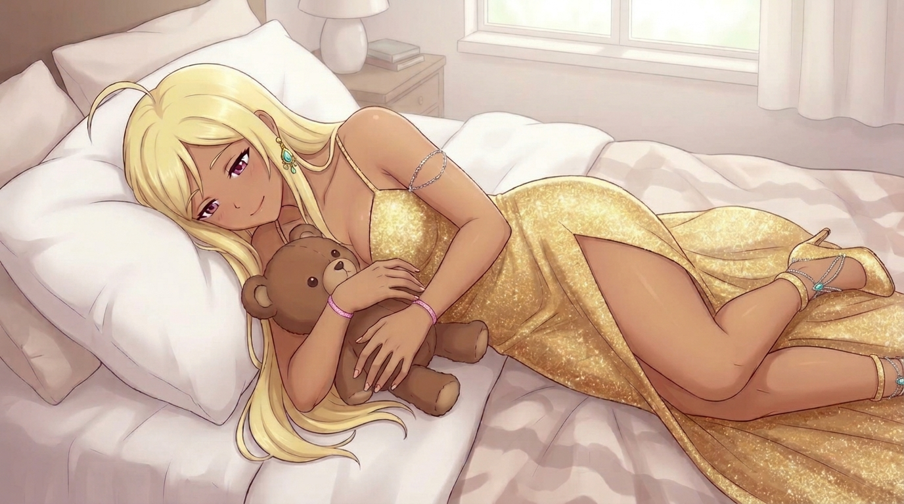

# HoppiTex
An Austrian Game Developer.

Yo I'm Daniel, known online as HoppiTex.
I like programming, writing stories and creating visual things of all kind.
This README is a "short" summary of what i can do and what i already created!

# Roles
## [TrafkHop Entertainment](https://trafkhop-entertainment.github.io/TrafkSite/)

I am the founder and owner of TrafkHop Entertainment. An indie studio that makes all sorts of games and projects and focuses on Lore and uniqueness!
## [HoppiTex (YouTube)](https://www.youtube.com/channel/UC6-vTkr3zUZ_d_f7y-Per9w)
I also make letsplays (in german) as a way to preserve my first gaming experiences (archive like).
## [TetraBox](https://trafkhop-entertainment.github.io/TrafkSite/Studio/TetraBox/TetraBox.html)

TetraBox is a small collaboration of 4 studios (inc TrafkHop). I made the name and the colors.
# Education
- HTL Steyr (IT) + Matura Abschluss
### Languages:
- German (Native)
- English

# [Projects](https://trafkhop-entertainment.github.io/TrafkSite/Projects/Projects.html)
Those are (for now) my most relevant projects! (for a full list, visit the TrafkHop Website linked in this header)

|                               |                         | TrafkVerse Wallpaper                                                                          |                                                         |                                                                     | TrafkCalc                                                                                      |
| ------------------------------------------------------------- | --------------------------------------------------------------------- | --------------------------------------------------------------------------------------------- | ----------------------------------------------------------------------------------- | ---------------------------------------------------------------------------------------------- | ---------------------------------------------------------------------------------------------- |
|                                      |                                                  |                                                                         |                                                               | - Notes - Images - Audios - Models - Code - Documents - GDScenes             |                                                                                             |
| An Arch Linux based Distribution that has an artistic vision. | A collection of 15 old Scratch Games that i made quite some time ago. | A wallpaper program that generates symbols and shapes that all play sounds making nice music! | TrafkHop's website! There you can find all sorts of infos, even infos of me!  | A collection of Assets that TrafkHop made and uses. Some are available to use in fan projects! | A simple Calculator app for you lore, so that we do not have to manually calculate everything. |

# Skills:
## 3D Modeling

|  |  |
| :--------------------: | :--------------------: |
I can model, rig, weightpaint and animate 3D Models up to an early 2000's model density and quality (Gamecube/Dreamcast Era)!

|  |  |  |  |  |
| :--------------------: | :--------------------: | ---------------------- | ---------------------- | ---------------------- |

## Scratch | Penguinmod Game Dev

I am able to create pretty much any 2D game in Penguinmod – with the help of plugins and enough time!

## Programming

| C                                                                                  | Bash                                                                                                    | HTML + CSS                                                                | JavaScript                                                                                     |
| ---------------------------------------------------------------------------------- | ------------------------------------------------------------------------------------------------------- | ------------------------------------------------------------------------- | ---------------------------------------------------------------------------------------------- |
| I can program a little bit of C, simple functions, Loops, File Writing and inputs. | I can program very simple loops and inputs. Rock, Paper, Scissors in Bash was my most difficult project. | I can make websites! I know the most important things about HTML and CSS! | I know very little JavaScript, simple console outputs, addition, loops and Website pop up boxes. |

## Character Designing
I think I can design characters pretty well. Here some examples:

|  |   |     |   |   |
| ---------------------- | -------------------------- | ---------------------------- | -------------------------- | -------------------------- |
| Filan Zöhl (OC)        | Pyley Jagl (OC)            | Lisß Rosa (OC) (image is AI) | Wuntbruh (OC)(VeryOld)     | Alfonz (OC)                |

## Linux
I am a normalish Linux user, I can navigate around with the terminal and stuff.

With the help of AI, I have also made my very own Linux Distribution, that is visually and functionally 100% my work (code is generated, art is human made)

|  |
| --------------------------- |
|    |

## Story writing
I would say I am pretty good at writing stories with enough time. You can / will be able to see my skills in my current/upcoming games and projects!

I can say that i have created a fully unique universe with its own mathematicly aligned magic system that is logical and unique! In this universe, many different worlds, creatures, cultures and storys exist in a balance, that is threatened at every step of the way. Stay tuned until i unvail them in my games!

## Drawing
|  |  |
| :-------------------------: | :-------------------------: |
I can draw a bit, not well but a little bit.

## AI Prompting
### Coding
As I already said, with the help of AI, I coded some apps and features of TrafkTux (my Linux distro), so I am able to code with AI – though I am not good, it takes a lot of chatting and no program ever (except TVW) was "done" with 1 prompt.
**TrafkVerse Screensaver** is the one project that had its very first version ready with only 1 prompt and still looked exactly like how my vision intended it to look!

### Image Generation
I can generate images with a prompt. As I am a visual thinker, i am pretty good at describing places (sometimes). But i cannot for the live of me generate good looking male characters (ai models are not trained on them much). I can create scenary and female characters. Here some examples:

| [Perchance ai-anime-generator](https://perchance.org/ai-anime-generator) (AI image)                                                   | ChatGPT (AI image)                                     | Gemini (AI image)                                                 |
| ------------------------------------------------------------------------------------------------------------------------------------- | ------------------------------------------------------ | ----------------------------------------------------------------- |
|                                                                                                                |                                 |                                            |
| This is one of my testing images from my perchance prompt with weights. This is where i usually test my character image descriptions. | A wallpaper i generated for TrafkTux as a placeholder. | This image was a test for a complex dress in a complex situation. |
The character visible is my OC called "Lisß Rosa" and is one of the 3 main characters of my main story.

#### Stand on ai art generation:
Personally I don't mind using ai imagery to test image descriptions – i do that and it does help somewhat, though i do not use it for anything else as ai cannot create my visions (its too incompitent).
My opinion is that if you only use AI generated art for personal use or for placeholders or for free assets in a free project, then I think it is okay. If it is in marketing or a paid product or somewhere you can see it very easily and it is something that signals someone that this is what you are doing, then it is in my opinion definitely not ok!

# Future Plans
I am still learning at the moment, so it will take quite some time until my first real games will be released.

**A short roadmap on what i have planned on doing and learning**

| Godot & GDScript                                                                                                     | LMMS                                                                                                 | Javascript + server stuff                                                                            | LORE                                                                                                                                                                                                                                                                                                                                                                                                          |
| -------------------------------------------------------------------------------------------------------------------- | ---------------------------------------------------------------------------------------------------- | ---------------------------------------------------------------------------------------------------- | ------------------------------------------------------------------------------------------------------------------------------------------------------------------------------------------------------------------------------------------------------------------------------------------------------------------------------------------------------------------------------------------------------------- |
| For creating my games, i need a engine to do so and godot is perfect for my workflow. I just need to learn it first. | For games you need music and for music you need a program. LMMS is great, i just need to "get good". | For polishing the TrafkHop Website, i will need to learn Javascript and other server related things. | All my projects and games share one universe: the **TrafkVerse**. Their stories are interconnected, including non game projects. A game can only exist if its story exists up to that point. My core universal principles and magic system are done! Story, culture, and geography are still missing. Right now I’m writing a shortened version of the story that will be the foundation for everything else. |

# End
The end of my README..
Thanks for readind and have a great day!